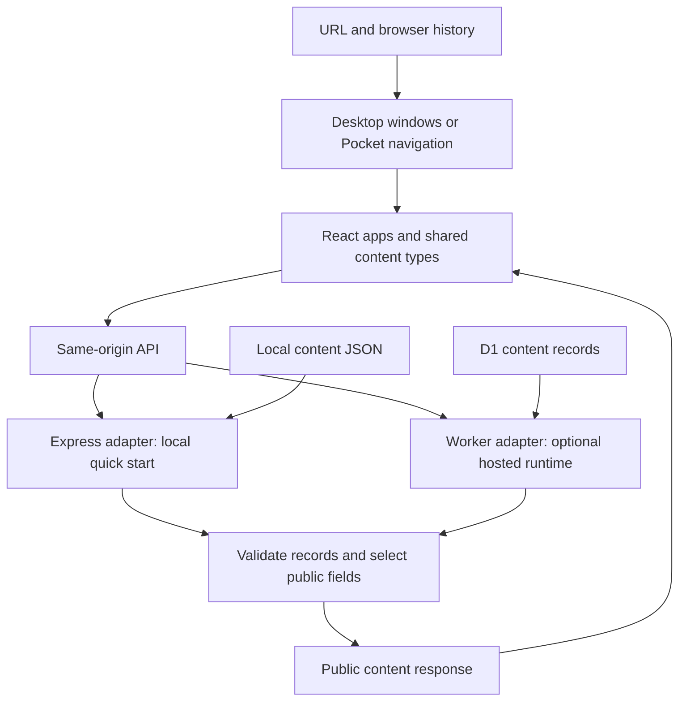

# Architecture and a guided code tour

Mendez 95 has two presentation layouts over shared application concepts. Express supports the local demo; the Worker adapter implements the service boundary for another runtime. Both keep editorial validation and public projection explicit.

The adapters are alternatives. The quick start runs Express and loads the fictional JSON included here. It needs neither D1 nor the private project.

## Tour 1: follow a window from a URL

1. [`src/App.tsx`](../src/App.tsx) composes the app and loads content. [`router.ts`](../src/desktop/router.ts) resolves paths; [`registry.ts`](../src/desktop/registry.ts) describes available apps.
2. [`useDesktop.ts`](../src/desktop/useDesktop.ts) connects navigation to browser history and window state. [`windowLifecycle.ts`](../src/desktop/windowLifecycle.ts) contains window-state rules.
3. [`DesktopShell.tsx`](../src/desktop/DesktopShell.tsx) and [`ManagedWindows.tsx`](../src/desktop/ManagedWindows.tsx) render the desktop. Focus changes and Back navigation work alongside mounted windows.
4. [`layout.ts`](../src/pocket/layout.ts) selects the smaller-screen layout. [`PocketChrome.tsx`](../src/pocket/PocketChrome.tsx) supplies navigation; [`AppView.tsx`](../src/apps/AppView.tsx) connects routes to app views.

Open Portfolio, open a case and use Back. Then inspect [`windowLifecycle.test.ts`](../src/desktop/windowLifecycle.test.ts) and [`layout.test.ts`](../src/pocket/layout.test.ts) for behavior checks that run independently of the UI.

## Tour 2: follow content across the public boundary

1. Express [`readContent`](../server/content.ts) loads named collections from `content/` or a configured directory. The [Worker implementation](../worker/content.ts) reads collections from D1.
2. [`types.ts`](../src/content/types.ts) describes records and editorial metadata. [`validation.ts`](../src/content/validation.ts) validates those records and produces an explicit public projection.
3. Public API responses omit editorial provenance and unpublishable records. [`server/exampleContent.test.ts`](../server/exampleContent.test.ts) checks the sample API, media access and authentication; [`exampleContent.test.ts`](../src/content/exampleContent.test.ts) checks publication and metadata filtering.
4. Owner editing uses authentication and CSRF checks in [`auth.ts`](../server/auth.ts). Runtime state and backups stay outside static asset directories. API filtering does not make source JSON committed to a public repository private.

Try the fictional case from the [customization tutorial](CUSTOMIZATION.md). Its editorial reference is present in source JSON and absent from the public API response.

## Tour 3: understand this repository's publication boundary

This is a generated edition with independent Git history. The upstream publisher selects reviewed code, rewrites identity-specific defaults, overlays fictional data and sample artwork, and runs checks before publishing. Its private credentials and implementation are not part of a template copy or fork.

[`PUBLIC-EXPORT.json`](../PUBLIC-EXPORT.json) records generated file paths and SHA-256 digests. The [public check workflow](../.github/workflows/check.yml) builds and tests this edition using its own files. The [privacy guide](PRIVACY.md) explains exclusions and the narrow exception for reviewed screenshots of the fictional demo.

A template copy starts an independent project; a fork retains an upstream relationship. Both contain the runnable public edition. Neither receives the private source history or access to private storage.

## Other implementation choices

- [Paint](../src/apps/paint/) uses Canvas and keeps imported images in the browser.
- [Games](../src/apps/games/) isolate round state and make score submission optional.
- The [guide core](../server/guideCore.ts) assembles answers from visible content; [optional generation](../server/guideGeneration.ts) is a separate server integration.
- Widgets expose unavailable states when services are disabled or cannot be reached.

Public tests use fictional content and general behavior checks. Tests tied to a private biography, original media inventory or production release facts are excluded.
